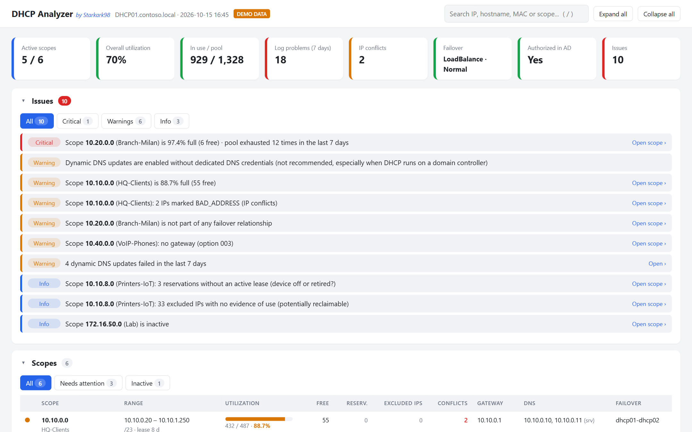
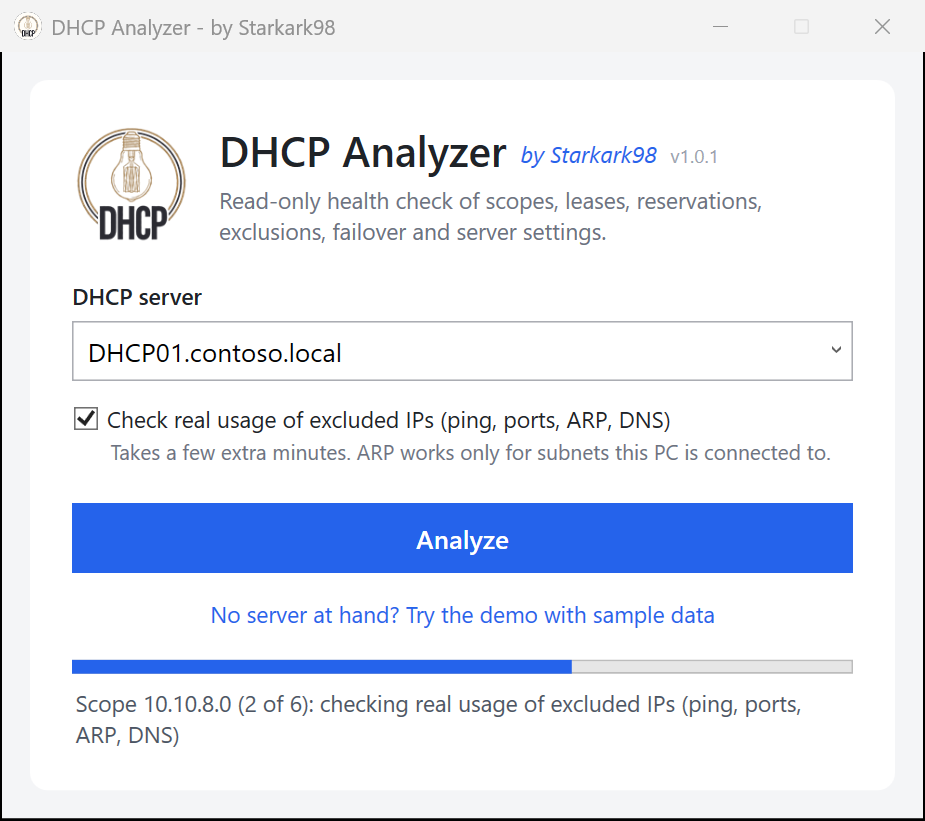
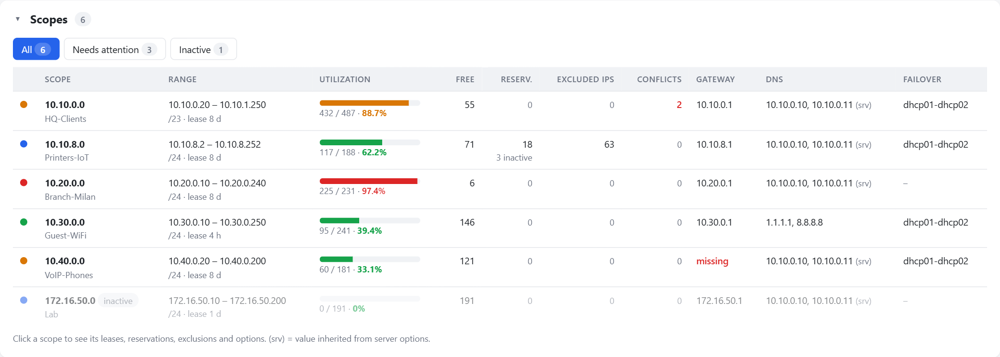
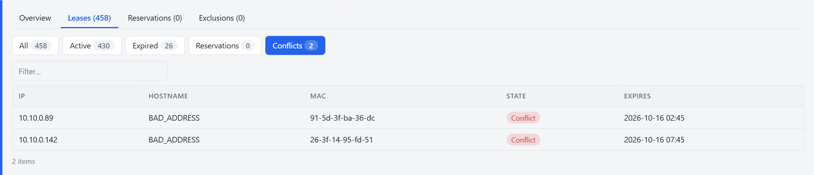
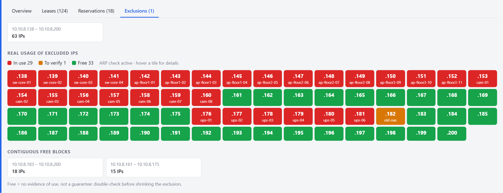
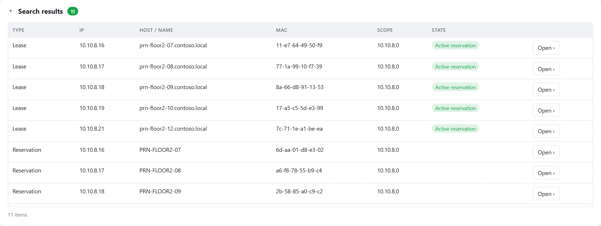
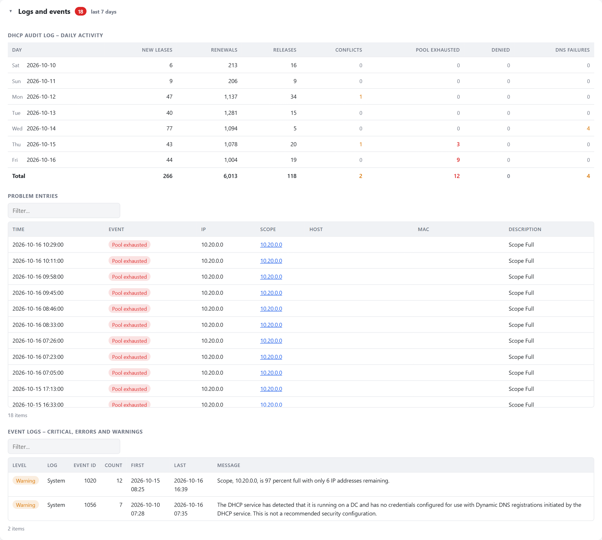
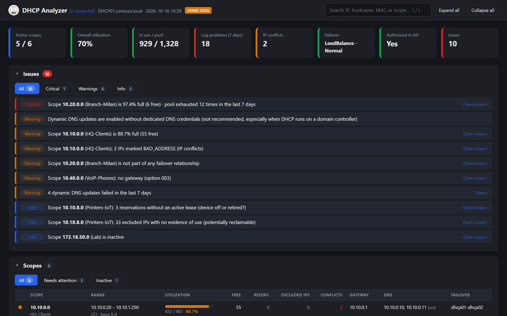

<p align="center">
  <picture>
    <source media="(prefers-color-scheme: dark)" srcset="docs/logo/logo-on-dark.png">
    
  </picture>
</p>

# DHCP Analyzer *by Starkark98*


-16a34a)

[](https://ko-fi.com/starkark98)

**A free, read-only health check for Windows DHCP servers — with an interactive dashboard you can understand at a glance.**

One PowerShell file, nothing to install on the server, no agents, no database. Point it at a DHCP server and in a few minutes you know how full your scopes are, where the conflicts are, whether failover is healthy, what the logs say about the last 7 days, and which excluded IPs are actually free to reclaim.



> **Want to see it first?** Download the ZIP from **Releases**, extract it and double-click **`Start Demo.cmd`**: the dashboard opens with realistic sample data. No DHCP server needed.

---

## Contents

- [Why DHCP Analyzer](#why-dhcp-analyzer)
- [Features](#features)
- [Requirements](#requirements)
- [Quick start](#quick-start)
- [Guided tour of the dashboard](#guided-tour-of-the-dashboard)
- [What the issues mean](#what-the-issues-mean)
- [Command line](#command-line)
- [Scheduled reports](#scheduled-reports)
- [How it works](#how-it-works)
- [Security and privacy](#security-and-privacy)
- [Responsible use](#responsible-use)
- [Limitations](#limitations)
- [Troubleshooting](#troubleshooting)
- [FAQ](#faq)
- [Getting help](#getting-help)
- [Support the project](#support-the-project)
- [Contributing](#contributing)
- [Project structure](#project-structure)
- [Maintainer](#maintainer)
- [Built with AI assistance](#built-with-ai-assistance)
- [Disclaimer](#disclaimer)
- [Trademarks](#trademarks)
- [License](#license)

---

## Why DHCP Analyzer

The DHCP console shows you data, one scope at a time. Windows IPAM is powerful but heavy to set up. Commercial IPAM suites cost money and need servers or agents.

DHCP Analyzer sits in between: you run it, and it tells you **what needs your attention** across the whole server, in plain language, with every detail one click away.

Its most distinctive feature is the **real usage check of excluded IP ranges**. Exclusions are usually created "for static devices" and never reviewed again. DHCP Analyzer pings, probes and looks up every excluded address and shows you a color map of what is really in use, so you can make an informed decision when a scope runs full.

## Features

- **Whole-server analysis** in one click: every scope, lease, reservation, exclusion, option, failover relationship and key server setting (service state, version, MAC filters, audit, DNS updates).
- **Logs and events of the last 7 days**: daily lease activity from the DHCP audit log (new, renewals, releases, conflicts, pool exhausted, denied, DNS failures) and DHCP errors and warnings from the Windows event logs, grouped and counted.
- **Prioritized issues** (critical, warning, info), each linked to the affected scope.
- **Scope overview** with utilization bars, free addresses, active and expired leases, reservations, conflicts, gateway, DNS and failover.
- **Scope details** in tabs: overview and options, leases (filterable by state), reservations (with live state), exclusions.
- **Real usage map of excluded IPs** (ping, common TCP ports, ARP, reverse DNS), with the list of contiguous free blocks.
- **Global search** by IP, hostname, MAC address (any format: `aa:bb:cc`, `aa-bb-cc`, `aabbcc`) or scope.
- **Collapsible sections**, sortable and filterable tables, automatic light/dark theme, print-friendly layout.
- **Self-contained HTML report**: one offline file you can save, archive or send to a colleague.
- **Read-only**: it never changes anything on your DHCP server.

## Requirements

| What | Details |
|---|---|
| PC running the tool | Windows 10/11 or Windows Server 2016 and later, with **Windows PowerShell 5.1** (built in). PowerShell 7 is not supported |
| PowerShell module | **DHCP Server Tools** (RSAT), see below. Not needed for the demo |
| Browser | Microsoft Edge, Google Chrome or Firefox. Internet Explorer is **not** supported |
| DHCP server | Windows Server with the DHCP Server role (IPv4 scopes) |
| Permissions | **DHCP Users** on the DHCP server is enough for the DHCP data. For the logs, see below |

**Permissions for the logs section** (optional: if they are missing, the rest of the report still works and the dashboard tells you what could not be read):

- **Event logs**: membership in **Event Log Readers** (or local administrators) on the DHCP server, and the firewall rule group **Remote Event Log Management** enabled on the server.
- **Audit log files** (`DhcpSrvLog-*.log`): they are read through the administrative share `\\server\C$`, so you need **local administrator** rights on the DHCP server, or run the tool on the server itself.

Install the RSAT DHCP tools on Windows 10/11 (run PowerShell as administrator):

```powershell
Add-WindowsCapability -Online -Name Rsat.DHCP.Tools~~~~0.0.1.0
```

On Windows Server:

```powershell
Install-WindowsFeature RSAT-DHCP
```

> **Tip:** run DHCP Analyzer from your admin workstation rather than on a domain controller. You get a modern browser for the dashboard and you avoid running interactive tools on a DC.

## Quick start

1. **Download** the ZIP of the latest version from the **Releases** section of this repository and extract it to any folder. If you want, compare its SHA-256 hash with the one published in the release notes (`Get-FileHash .\DhcpAnalyzer-v1.0.1.zip`).
2. **Unblock** the files. Windows marks downloaded files as untrusted; run this once in PowerShell, in the extracted folder:
   ```powershell
   Get-ChildItem -Recurse | Unblock-File
   ```
3. **Double-click `Start DhcpAnalyzer.cmd`.** Accept the administrator prompt (UAC), or decline it if your account already has DHCP read access.
4. **Choose the DHCP server.** Servers authorized in Active Directory are listed in the drop-down; you can also type a name or an IP address.
5. Leave **"Check real usage of excluded IPs"** ticked if you want the exclusion map (read [Responsible use](#responsible-use) first), then click **Analyze**.
6. When the analysis is complete the dashboard opens in your browser. Use **Save as...** to keep a copy.



> **Tip: a desktop shortcut with the logo.** `.cmd` files cannot carry an icon, but a shortcut can. Right-click `Start DhcpAnalyzer.cmd` → *Show more options* → *Create shortcut*, move the shortcut to your desktop, then *Properties* → *Change Icon...* → *Browse* and pick `docs\logo\DhcpAnalyzer.ico`.

## Guided tour of the dashboard

### 1. The summary bar

At the top you find eight key indicators: active scopes, overall utilization, addresses in use versus pool, log problems in the last 7 days, current IP conflicts, failover state, AD authorization and number of issues. Their colored edge tells you immediately whether something is wrong (green fine, amber warning, red critical). **Click any card** to jump to the related section.

### 2. Issues

Everything that deserves your attention, sorted by severity, in plain language. Use the chips to show only critical items, warnings or info. **Click an issue** to open the scope it refers to.

### 3. Scopes



One row per scope. The dot on the left is the scope's worst issue (green means no issues). The utilization bar turns amber above 80% and red above 95%. `(srv)` next to the gateway or DNS means the value is inherited from the server options. Use **Needs attention** to hide healthy scopes.

### 4. Scope details

**Click a scope row** to expand it. The tabs show:

- **Overview**: range, mask, lease duration, distributable pool, failover and all DHCP options (scope-level or inherited).
- **Leases**: every lease, filterable by *Active*, *Expired*, *Reservations*, *Conflicts*. Click a column header to sort, use the filter box to narrow the list.
- **Reservations**: all reservations with their current state. An *inactive reservation* usually means the device is off or has been retired.
- **Exclusions**: excluded ranges and, if the scan was enabled, the real usage map.



### 5. Real usage map of excluded IPs



Each tile is one excluded address:

| Color | Meaning |
|---|---|
| Red, **In use** | The address answered ping, a TCP port, or is in the ARP table |
| Amber, **To verify** | No answer, but a DNS record or a reservation exists (device possibly switched off) |
| Green, **Free** | No evidence of use |

Hover a tile to see what was found (ping time, open ports, MAC address, DNS name). Below the map, **contiguous free blocks** are listed from largest to smallest: these are the best candidates to review if you need to shrink an exclusion and grow the pool.

> **Important:** "Free" means *no evidence of use at the time of the scan*, not a guarantee. A device may simply be switched off or firewalled. Run the analysis at different times and cross-check with your inventory and documentation before changing any exclusion.

### 6. Global search



Type in the search box at the top (or press **`/`** anywhere) to search leases, reservations and in-use excluded IPs across **all scopes**. MAC addresses match in any format. Click **Open** to jump straight to the right tab of the right scope.

### 7. Logs and events



What happened in the **last 7 days** (today and the six previous days), from two sources:

- **DHCP audit log**: one row per day with new leases, renewals, releases and the problem counters (conflicts, pool exhausted, denied requests, DNS update failures). Below, every problem entry with time, IP, host, MAC and a link to its scope.
- **Windows event logs** (DHCP Admin and Operational channels, plus DHCP Server events in the System log): critical events, errors and warnings, grouped by event ID with count, first and last occurrence and message.

The section opens automatically when there is something to look at. *Pool exhausted* is the most important signal: it means clients asked for an address and did not get one.

### 8. Failover and server configuration

Collapsed by default when healthy. They show failover relationships (partner, mode, state, MCLT, auto switchover, scopes covered) and server settings: DHCP Server service state, server version, MAC allow/deny filters, conflict detection, audit log, database backup, dynamic DNS updates, name protection, DNS update credentials and server-level options.

Use **Expand all** and **Collapse all** in the top bar to open or close every section. The dashboard follows your system's light or dark theme:



## What the issues mean

The suggestions below are general guidance, not instructions for your specific environment: always evaluate them against your own network design and change-management process.

| Severity | Issue | What to check |
|---|---|---|
| Critical | DHCP Server service not running | Start the service and check the System event log for the reason it stopped |
| Critical | Server not authorized in AD | Authorize it (`Add-DhcpServerInDC`), otherwise it may stop serving clients |
| Critical | Address pool exhausted in the last 7 days | Clients already failed to get an address: act now (see the next row) |
| Critical | Scope above 95% | Clients may soon fail to get an address: extend the range, reclaim excluded IPs, shorten the lease, or split the network |
| Critical | Failover not in *Normal* state | Check connectivity and time sync between partners and the state in the DHCP console |
| Warning | Scope above 80% | Plan capacity before it becomes critical |
| Warning / Critical | Error events in the DHCP event logs | Open *Logs and events* and read the grouped messages |
| Warning | IP conflicts detected on the network | A device with a static IP is probably sitting inside the pool. Only conflicts not already shown as BAD_ADDRESS are reported here |
| Warning | Lease requests denied | Usually a MAC filter or a DHCP policy rejecting the client |
| Warning | Dynamic DNS updates failed | Check DNS credentials, zone permissions and secure-update settings |
| Warning | IPs marked BAD_ADDRESS | An address was declined by a client because another device was already using it: look for a static IP inside the pool |
| Warning | Missing gateway (003) or DNS (006) | Clients get an address but cannot route or resolve names |
| Warning | Scope not in failover | The scope has no redundancy while others do |
| Warning | No failover configured | The DHCP server is a single point of failure |
| Warning | Audit log disabled | You lose the history needed for troubleshooting and audits |
| Warning | Dynamic DNS updates without dedicated credentials | DHCP updates DNS with the server's computer account; on a domain controller this is a known security risk. Consider a dedicated low-privilege account |
| Info | Reservation without active lease | Device off or retired: consider removing the reservation |
| Info | Excluded IPs with no evidence of use | Potentially reclaimable addresses (verify first) |
| Info | Inactive scope | Intentional? If not, activate or delete it |
| Info | MAC allow list enabled | Only listed clients get an address: make sure this is intentional |
| Info | Logs could not be read | Missing permissions or firewall rule: see [Requirements](#requirements) |

## Command line

```powershell
.\DhcpAnalyzer.ps1 [-DhcpServer <name>] [-NoGui] [-SkipExclusionScan] [-Demo] [-OutHtml <path>] [-NoElevate] [-NoOpen]
```

| Parameter | Description |
|---|---|
| `-DhcpServer` | Server to analyze. With the window, pre-fills the field |
| `-NoGui` | Runs without the window, ideal for scheduled tasks |
| `-SkipExclusionScan` | Skips the network check of excluded IPs (faster, no network traffic towards the excluded addresses) |
| `-Demo` | Builds the dashboard from sample data |
| `-OutHtml` | Where to save the dashboard (default: `%TEMP%`). Missing folders are created; an existing file is overwritten |
| `-NoElevate` | Does not ask for administrator rights at startup |
| `-NoOpen` | Saves the dashboard without opening the browser: use it with `-NoGui` in scheduled tasks |

Examples:

```powershell
# Report saved to a share, without the exclusion scan and without opening the browser
.\DhcpAnalyzer.ps1 -DhcpServer DHCP01 -NoGui -NoOpen -SkipExclusionScan -OutHtml "\\fileserver\it\dhcp\dhcp01.html"

# Demo
.\DhcpAnalyzer.ps1 -Demo
```

## Scheduled reports

To get a fresh report every week, create a task in **Task Scheduler** with:

- **Program:** `powershell.exe`
- **Arguments:** `-NoProfile -ExecutionPolicy Bypass -File "C:\Tools\DhcpAnalyzer\DhcpAnalyzer.ps1" -DhcpServer DHCP01 -NoGui -NoOpen -SkipExclusionScan -OutHtml "\\fileserver\it\dhcp\dhcp01.html"`
- **Account:** a dedicated account that is a member of **DHCP Users** on the server (and, if you want the logs, of the groups listed in [Requirements](#requirements)), with write access to the output folder.

The report at `-OutHtml` is overwritten at every run. With `-NoGui`, an error ends the script with a non-zero exit code, visible as *Last Run Result* in Task Scheduler.

## How it works

DHCP Analyzer is a single Windows PowerShell script. When you click **Analyze** it:

1. **Reads the DHCP server** with the read-only cmdlets of the Microsoft `DhcpServer` module: `Get-DhcpServerv4Scope`, `Get-DhcpServerv4ScopeStatistics`, `Get-DhcpServerv4Lease -AllLeases`, `Get-DhcpServerv4Reservation`, `Get-DhcpServerv4ExclusionRange`, `Get-DhcpServerv4OptionValue`, `Get-DhcpServerv4Failover`, `Get-DhcpServerSetting`, `Get-DhcpServerDatabase`, `Get-DhcpServerAuditLog`, `Get-DhcpServerv4DnsSetting`, `Get-DhcpServerDnsCredential`, `Get-DhcpServerVersion`, `Get-DhcpServerv4FilterList`, `Get-DhcpServerv4Filter` (and `Get-DhcpServerInDC` to fill the server list).
2. **Reads service state and logs**: `Get-Service` for the DHCP Server service, `Get-WinEvent` for the DHCP event logs, and the `DhcpSrvLog-*.log` audit files, opened read-only.
3. **Optionally checks excluded IPs** of active scopes from your PC: ICMP ping (3 passes, 1 s timeout), TCP connection attempts on ports 22, 80, 135, 443, 445, 3389 and 9100 (1 s timeout, no data sent), the local ARP table, and a reverse DNS lookup through your configured DNS servers.
4. **Builds the dashboard**: all data is embedded in one HTML file with inline styles and scripts, written to `%TEMP%` (or to `-OutHtml`) and opened in your browser.

You can read the whole source in [`DhcpAnalyzer.ps1`](DhcpAnalyzer.ps1) before running it.

## Security and privacy

- **Read-only.** DHCP Analyzer only uses the `Get-*` cmdlets listed above and opens the audit log files in read-only mode. It never creates, modifies or deletes anything on the DHCP server.
- **No data leaves your network.** No telemetry, no update checks, no calls to the internet, no external libraries. The dashboard is a single offline HTML file.
- **Files written on your PC:** the HTML report (in `%TEMP%` unless you choose another path) and the name of the last server analyzed (`%APPDATA%\DhcpAnalyzer\last.txt`). Delete them whenever you want.
- **The report contains sensitive data**: hostnames, MAC addresses, IP plan, server configuration. Hostnames and MAC addresses can identify people and may qualify as **personal data** under laws such as the GDPR. Store, share and delete reports according to your organization's policies, as you would any internal network documentation.
- **The exclusion scan generates network traffic** (see [How it works](#how-it-works)). It is light, but an IDS/IPS or EDR may flag it as a port scan: inform your security team in advance, or untick the option / use `-SkipExclusionScan`.
- **Administrator prompt.** The launcher asks for elevation because local access to the DHCP service can require it. You can decline the prompt or use `-NoElevate`.
- **Found a vulnerability?** Please report it privately as described in [SECURITY.md](SECURITY.md), not in a public issue.

## Responsible use

DHCP Analyzer is an administration tool intended for **IT staff analyzing infrastructure they manage**.

- Run it **only against DHCP servers and networks you own or are explicitly authorized to administer**.
- The exclusion scan sends ping and TCP connection attempts to the excluded addresses. Even if light, **network probing without authorization may violate your organization's policies, contracts or local laws**. Obtain the required approvals before using it, or disable the scan.
- You are solely responsible for how you use the tool and for any changes you make to your systems based on its results.

## Limitations

- **IPv4 only**: IPv6 scopes are not analyzed.
- **Point-in-time picture**: the report reflects the moment of the analysis. Devices that are switched off, asleep or firewalled may look unused.
- **ARP check** works only for subnets the PC running the tool is directly connected to.
- **Exclusion scan** is skipped for scopes with more than 1024 excluded addresses and for inactive scopes.
- **Logs**: up to 1000 events per event log and the latest 500 problem entries of the audit log are shown. Remote audit files are reached through the administrative share of their drive (for example `C$`), and `%windir%` in the audit path is assumed to be `C:\Windows`.
- **One server per run**: in a failover pair, analyze one partner; to compare servers, run the tool once per server.
- **Windows PowerShell 5.1** is required; PowerShell 7 is not supported.

## Troubleshooting

| Message or symptom | Cause and fix |
|---|---|
| `ACCESS DENIED` / `Failed to enumerate scopes` with `WIN32 5` | Accept the UAC prompt, and make sure your account is in **DHCP Users** or **DHCP Administrators** on the server |
| `RPC SERVER UNAVAILABLE` (`WIN32 1722`) | Wrong name, DHCP service stopped, or firewall blocking RPC (TCP 135 + dynamic ports) |
| `SERVER NOT FOUND` | Check the name and DNS resolution; try the IP address |
| `DhcpServer module not found` | Install the RSAT DHCP tools (see [Requirements](#requirements)) |
| Blank page, or Internet Explorer "restricted this webpage" bar | IE cannot run the dashboard. Open the file with Edge or Chrome, or run the tool from a PC that has them |
| "No modern browser was found" | Same as above: use **Save as...** / **Show in folder** and open the file elsewhere |
| The window does not open, or a script error mentions execution policy | Unblock the files (`Get-ChildItem -Recurse \| Unblock-File`) and start from `Start DhcpAnalyzer.cmd` |
| The program stops with "unexpected error" | Copy the message and open a bug report (see [Getting help](#getting-help)) |
| "Event logs could not be read" | Add your account to **Event Log Readers** on the server and enable the firewall rule group **Remote Event Log Management** |
| "Audit log files could not be read" | You need local administrator rights on the DHCP server (access to `\\server\C$`), or run the tool on the server |
| Logs section shows "Audit log is disabled" | Enable it in the DHCP console (server properties, *Enable DHCP audit logging*) to get lease history |
| Exclusion map shows "ARP not available" | Normal when the PC is not on that subnet: the result relies on ping, ports and DNS only |
| Many excluded IPs shown as "Free" but you know they are used | Devices may be off or firewalled. Run again at a busy time, from a PC on the same subnet |
| Antivirus or EDR warns about the script | The launcher starts PowerShell hidden with `-ExecutionPolicy Bypass` and the exclusion scan probes TCP ports: both are typical of admin tools. Review the source, then ask your security team to allow it, or run with `-SkipExclusionScan` |

## FAQ

**Does it change anything on my DHCP server?**
No. It only reads data. See [How it works](#how-it-works) for the complete list of commands it uses.

**Does it work with DHCP failover?**
Yes. Relationships, state and covered scopes are shown, and scopes not protected by failover are flagged. Run the analysis against one partner.

**Can I analyze several servers?**
Run it once per server. Each report is a separate file.

**Does it support IPv6 scopes?**
Not yet: version 1.0.x analyzes IPv4 only.

**Is it really free?**
Yes, to use. Individuals and organizations of any kind, companies included, can use it on their own networks at no cost. What is not allowed is **selling** it, or selling products or services based on it: see [License](#license). If it saves you time, consider giving the project a star on GitHub or [supporting it on Ko-fi](#support-the-project).

## Getting help

- **Questions, bugs and ideas:** open an issue in the **Issues** section of this repository, using the *Bug report* or *Feature request* template. For bugs, include the error message shown in the window (you can select and copy it).
- **Before posting**, remove server names, IP addresses, hostnames and MAC addresses you do not want to make public. Never attach a real report.
- **Security vulnerabilities:** follow [SECURITY.md](SECURITY.md).

DHCP Analyzer is maintained in spare time. Support is **best effort**: there is no guaranteed response time and no service-level agreement.

## Support the project

DHCP Analyzer is free and maintained in spare time. If it saves you time or helps you avoid an outage, you can support its development with a small donation:

[](https://ko-fi.com/starkark98)

Donations are entirely voluntary and do not buy support, priority or a commercial license. Starring the repository, reporting bugs and sharing the tool with colleagues help just as much.

## Contributing

Contributions are welcome. Please read [CONTRIBUTING.md](CONTRIBUTING.md) before opening a pull request. In short: open an issue first to discuss larger changes, keep the tool strictly read-only, and keep it compatible with Windows PowerShell 5.1. By submitting a contribution you agree that it is released under the same [license](LICENSE) as the project (MIT with the Commons Clause).

## Project structure

```
DhcpAnalyzer.ps1          The whole application: analysis engine, dashboard template and window
Start DhcpAnalyzer.cmd    Launcher (double-click)
Start Demo.cmd            Opens the dashboard with sample data
docs/images/              Screenshots used in this README
docs/logo/                Logo (light and dark backgrounds), app icon (.png, .ico)
CHANGELOG.md              Version history
SECURITY.md               How to report vulnerabilities
CONTRIBUTING.md           How to contribute
LICENSE                   MIT License with the Commons Clause (no selling)
```

## Maintainer

DHCP Analyzer is created and maintained by **Starkark98**. Version history is in [CHANGELOG.md](CHANGELOG.md).

## Built with AI assistance

In the spirit of transparency: DHCP Analyzer was developed with the assistance of **[Claude Code](https://www.anthropic.com/claude-code)**, Anthropic's AI coding assistant, which helped write, review and debug the code and the documentation. The maintainer defined the goals and the design, directed the work, reviewed the results and is responsible for the project.

As with any tool, read the source and evaluate the results critically before relying on them (see [Disclaimer](#disclaimer)).

## Disclaimer

DHCP Analyzer is provided **"as is", without warranty of any kind**, express or implied, as stated in the [LICENSE](LICENSE).

- The results are **diagnostic indications based on heuristics** and on the data available at the time of the analysis. They may be incomplete or inaccurate and **do not replace the judgment of a qualified administrator**.
- **Verify every finding** against your documentation and inventory, and follow your change-management process **before modifying any configuration** (for example exclusions, scopes, reservations or failover). Where possible, test changes outside production first.
- In no event shall the author or contributors be liable for any claim, damages or other liability, including service outages, address conflicts, data loss, security incidents or decisions taken on the basis of the reports, arising from the use of or inability to use this software.
- DHCP Analyzer is an **independent project**. It is not affiliated with, endorsed by or supported by Microsoft Corporation.

## Trademarks

Microsoft, Windows, Windows Server, Active Directory, PowerShell, Internet Explorer and Microsoft Edge are trademarks of the Microsoft group of companies. Google Chrome is a trademark of Google LLC. Firefox is a trademark of the Mozilla Foundation. Claude and Claude Code are trademarks of Anthropic, PBC. All other trademarks are the property of their respective owners. Their use here is for identification purposes only and does not imply endorsement.

## License

Copyright (c) 2026 Starkark98. Released under the **MIT License with the [Commons Clause](https://commonsclause.com/)** condition: see [LICENSE](LICENSE) for the full text.

In plain words (the LICENSE file is what legally applies):

| You can | You cannot |
|---|---|
| Use it for free, at home or at work, in companies, schools and public bodies | **Sell** it, alone or bundled with other software |
| Run it on the networks you manage, including your company's or your employer's | Offer paid hosting, support or **consulting services whose value derives entirely or substantially from it** (for example selling DHCP audits produced with it) |
| Modify it and share it, including modified versions, **free of charge** | Remove the copyright notice or the license text |

Any copy or modified version must keep the [LICENSE](LICENSE) file, including the Commons Clause.

Because of the Commons Clause, DHCP Analyzer is **source-available** software, not "open source" in the OSI sense.

**Commercial use not covered above?** If you would like to sell, bundle or offer services based on DHCP Analyzer, contact **Starkark98** through GitHub to ask for a separate commercial license.

---

*DHCP Analyzer by **Starkark98** · v1.0.1 · see the [changelog](CHANGELOG.md)*
